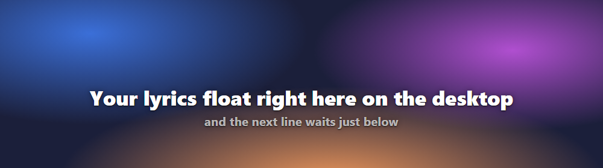
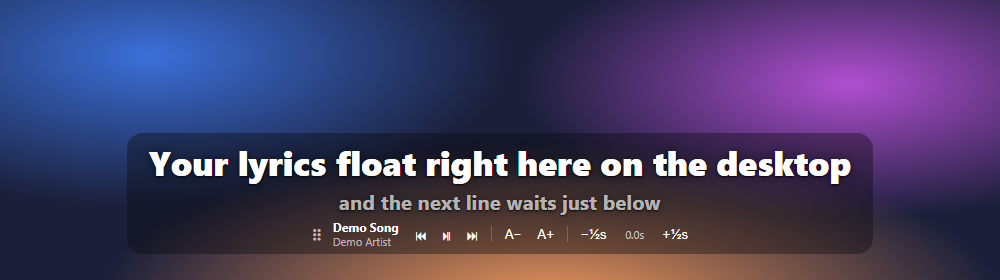

# Spotify Lyrics Overlay

Synced lyrics from the **Spotify Web Player** floating on top of your desktop. They show as text only, with no window and no background, and they keep following the song while you work in other tabs or apps.



Hover the lyrics to get a thin backdrop and playback controls:



## Features

- **Transparent, click-through overlay.** Only the lyric text (with a soft shadow) is drawn on screen. Clicks pass straight through to whatever is underneath.
- **Line-synced lyrics.** The overlay shows the current line large and the next line smaller below it.
- **Hover controls.** Previous / play-pause / next, text size, and a per-track timing offset (±0.5 s).
- **Drag anywhere.** Grab the ⠿ handle to move the overlay. Its position is remembered.
- **Tray menu.** Show/hide, width (Small / Medium / Large), reset position, start at login, quit.
- **No-install fallback.** If the overlay app isn't running, the extension can open a small always-on-top lyrics window (Document Picture-in-Picture) straight from the Spotify tab.
- **Free lyrics source.** Lyrics come from [LRCLIB](https://lrclib.net). No account or API key is needed.

## How it works

```
open.spotify.com tab                Chrome extension                  Overlay app (Electron)
┌──────────────────────┐  postMessage  ┌──────────────────────┐  WebSocket   ┌──────────────────────┐
│ page.js (MAIN world) │ ────────────▶ │ bridge.js            │ ───────────▶ │ ws://127.0.0.1:47823 │
│ reads track + clock  │ ◀──────────── │ background.js        │ ◀─────────── │ transparent window   │
│ clicks play/next     │   commands    │ (lyrics via LRCLIB)  │   commands   │ renders the lyrics   │
└──────────────────────┘               └──────────────────────┘              └──────────────────────┘
```

1. `page.js` runs inside the Spotify Web Player. It reads the now-playing track from `navigator.mediaSession` and the playback position from Spotify's media element, `setPositionState`, or the progress bar.
2. `background.js` looks up the lyrics on LRCLIB and relays everything to the overlay app over a local WebSocket.
3. The overlay app draws the lyrics in a transparent, always-on-top window and keeps its own clock, so the text stays in sync between updates.

## Requirements

- **Google Chrome or Microsoft Edge 116+** (any Chromium browser with Manifest V3 should work)
- **Node.js 18+** and npm, for the overlay app
- Windows 10/11. This is the tested platform. macOS and Linux should work since the overlay is plain Electron, but they haven't been tested yet. On Linux you need a compositor for transparency.

## Installation

### 1. Get the code

```bash
git clone https://github.com/firdausmego/spotify-lyrics-overlay.git
cd spotify-lyrics-overlay
```

### 2. Load the Chrome extension

1. Open `chrome://extensions` (or `edge://extensions`).
2. Turn on **Developer mode**.
3. Click **Load unpacked** and select the `extension` folder.
4. Refresh any open `open.spotify.com` tab.

### 3. Install and start the overlay app

```bash
cd overlay
npm install
npm start
```

On Windows you can double-click **`overlay/Start Lyrics Overlay.vbs`** to start it without a console window. Use **Start at login** in the tray menu to launch it automatically.

## Usage

1. Start the overlay app. A ♪ icon appears in the system tray.
2. Play something on [open.spotify.com](https://open.spotify.com).
3. The lyrics appear near the bottom of your screen within a few seconds.

| Action | How |
| --- | --- |
| Show controls | Hover over the lyrics |
| Move the overlay | Drag the ⠿ handle |
| Previous / play-pause / next | ⏮ ⏯ ⏭ buttons |
| Text size | A− / A+ |
| Lyrics too early / too late | −½s / +½s (saved per track) |
| Width, hide, reset, autostart, quit | Right-click the tray icon |

### Fallback: floating window without the app

Without the overlay app running, click the green **♪** button in the Spotify tab or press **Alt+L**. A small always-on-top lyrics window opens and stays visible when you switch tabs or minimize the browser. Chrome doesn't allow these windows to be transparent, so this mode always has a background.

## Troubleshooting

- **No lyrics found.** LRCLIB is community-maintained and doesn't have every track. If a song has no synced lyrics, the overlay shows a short notice and then hides it.
- **Lyrics are out of sync.** Use −½s / +½s. The offset is saved for that track.
- **The overlay says "Waiting for Spotify in Chrome…"** Make sure the extension is loaded and refresh the Spotify tab, especially after reloading the extension.
- **"WebSocket connection failed" on `chrome://extensions`.** This is expected while the overlay app isn't running. The extension keeps retrying in the background, and the message is harmless.
- **"Could not open port 47823".** Another program, or another copy of the overlay, is using that port. Close it and start the overlay again.

## Privacy

- No analytics and no accounts.
- The only external request is to `lrclib.net`, sending the track title, artist, album and duration to find lyrics.
- The overlay app listens on `127.0.0.1` only. It accepts connections from browser extensions only, so websites cannot connect to it.
- Settings are stored locally: text size and offsets in the Spotify tab's `localStorage`, and window position in the overlay's config file.

## Project structure

```
extension/          Chrome extension (Manifest V3)
  manifest.json
  page.js           runs in the Spotify page: track + clock, fallback PiP window
  bridge.js         relays between the page and the service worker
  background.js     LRCLIB lookup + WebSocket relay to the overlay app
  popup.html        toolbar popup with quick instructions
overlay/            Electron desktop overlay
  main.js           transparent window, click-through hover logic, tray, WebSocket server
  preload.js        safe IPC bridge for the renderer
  renderer.js       lyric rendering, controls
  overlay.css       text-only look, hover backdrop
docs/               screenshots
```

## Known limitations

- The extension depends on how the Spotify Web Player exposes the current track and position. If Spotify changes its web player, syncing may need an update.
- It only works with the **web player** in the browser, not the Spotify desktop app.
- It doesn't support karaoke-style word-by-word highlighting yet, because LRCLIB provides line timing only.

## Contributing

Issues and pull requests are welcome. Ideas for future work include packaged installers (e.g. electron-builder), word-level timing, and more lyric sources.

## Credits

- Lyrics by [LRCLIB](https://lrclib.net). Please consider supporting the project.
- This project is not affiliated with, endorsed by, or connected to Spotify. "Spotify" is a trademark of Spotify AB.

## License

[CC0 1.0 Universal](LICENSE), public domain dedication.
